# IncreArt GUI gallery

Every screenshot in order, full size. Generated by
`scripts/make-gui-gallery.sh` from the captions in the
[screens table](README.md); don't edit by hand.

## 01-library-dialog

Start-up: what a library is and why one is opened first; recent libraries (last used in the accent colour), Create a new library… / Open an existing library…

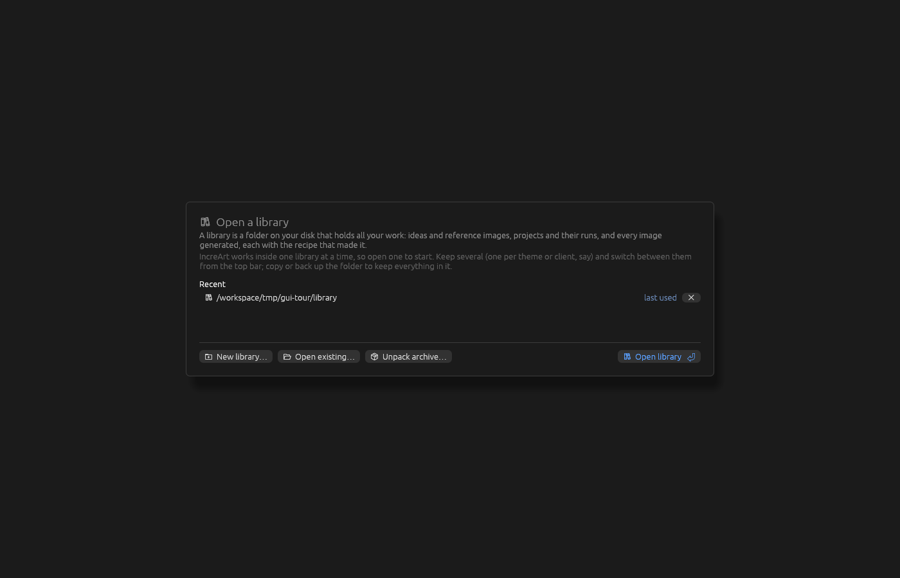

## 02-server-dialog

Start-up: server presets, each with its servers and what they do (images · text · vision) (a click opens one; ✎ edit, 🗑 delete), Open the last used, New preset / Set up KoboldCpp for your GPUs…, Server settings…

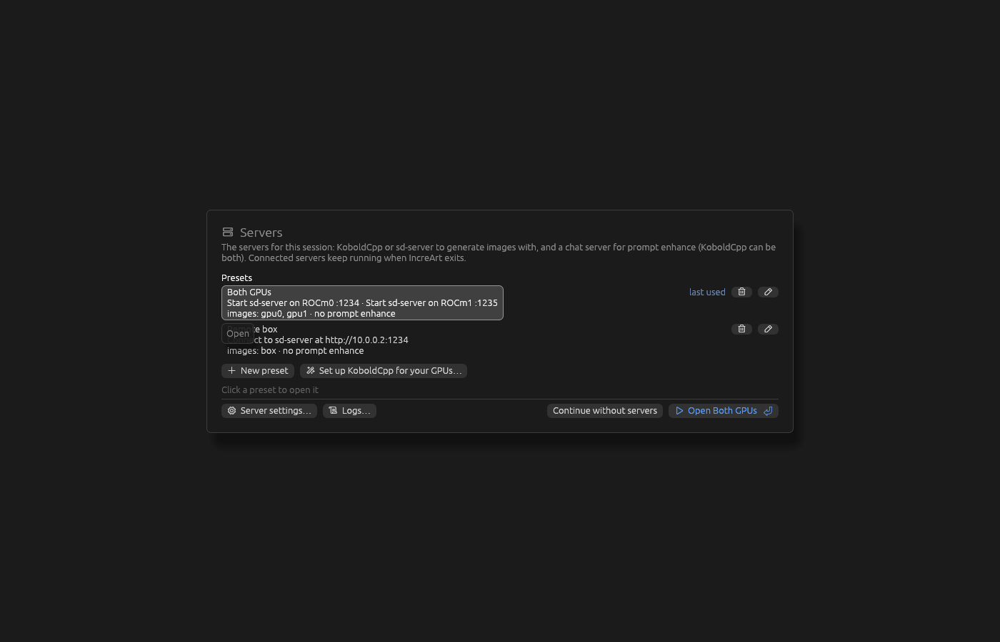

## 02c-koboldcpp-entry

## 03-idea-inbox-grid

Idea inbox grid: keys panel, card-size zoom, the drop-folder hint

## 04-idea-inbox-new-idea

New idea form

## 05-input-library

Input library: folder tree, selection actions, cards

## 06-projects-grid

Projects: tree and project tiles (cover, counts); the details pane on the right with the folder's totals

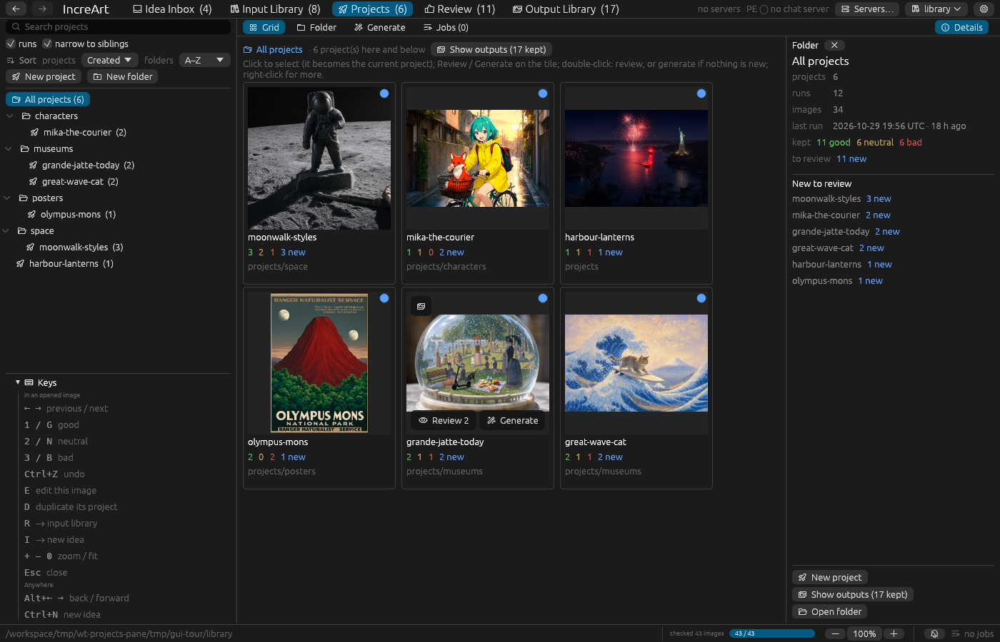

## 06b-projects-pane

Projects → Grid, a project selected: the details pane (cover, counts, source ideas, latest run, recent runs, best outputs; Generate / Review / Show outputs / Open folder pinned at the bottom)

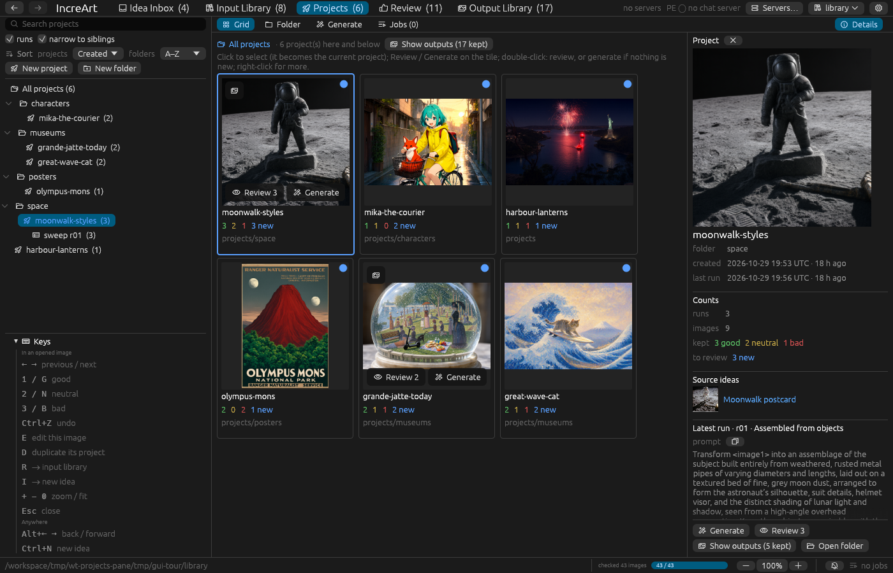

## 06c-projects-pane-run

Projects → Folder inside a run: the details pane shows the run (prompt, settings, input images, seeds, revisions; Open in Generate / Show outputs / Details)

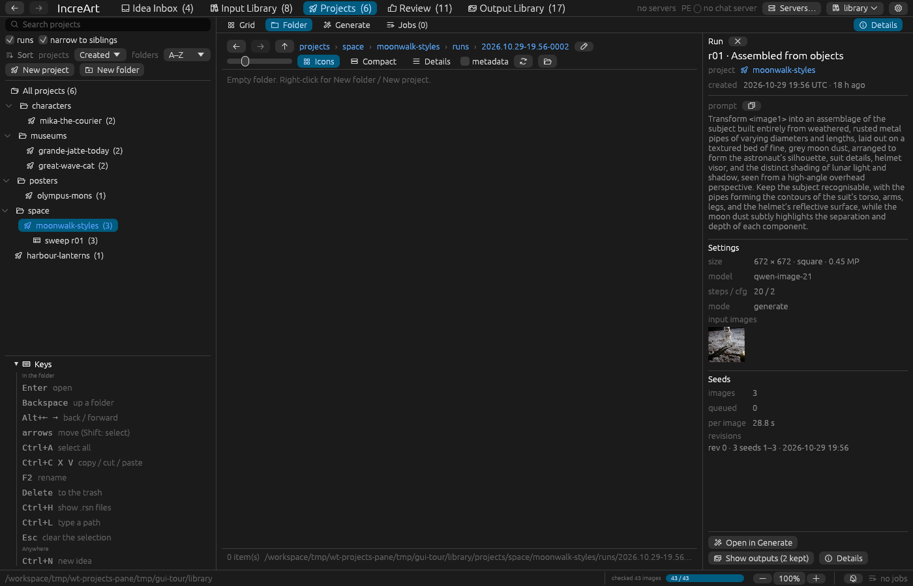

## 07-projects-generate

Generate: the form, and the Images pane on the right (each image a `<imageN>` reference, the start image, both, or parked)

## 07b-generate-blanks

Generate, a single run whose prompt has blanks: the **Blanks** table under the prompt (a value each, prompt enhance's suggestions, Suggest for the empty ones), filled in when queued

## 08-projects-jobs

Jobs: servers and running runs

## 09-review

Review: scope, image, recipe, verdicts, filmstrip

## 10-output-library

Output library: all projects, Kept tab (the Grid's preset tabs: Kept · Good · Rejected · Unreviewed · All)

## 11-jobs-popover

Status bar jobs indicator and its popover (engine state simulated by the tour)

## 12-review-grid

Review → Grid

## 13-review-compare

Review → A/B compare: B (the next image, which ← → change) on the left, A pinned on the right with its own buttons

## 13c-review-compare-with

Review → Compare with… (`Shift+C`): the picker opens on the image's references, its project's next; one click makes it A

## 13d-review-compare-input

Review → A/B compare against an input image: A has no rating buttons, the keys rate B

## 14-output-library-rejected

Output library → Grid → Rejected tab: the source's bad images, with Delete these N rejected…

## 14b-output-library-compare

Output library → right-click → Compare with…: the Grid shows A beside the selected image (B), ←/→ step B

## 15-generate-img2img

Generate in a project set to img2img: start image with strength, refs counter

## 16-servers-opening

Server dialog while opening: locked and dimmed, progress, Continue in background / Cancel

## 17-prompt-history

Generate history: entries newest first with the settings changed and the runs they led to, word diff and settings against the current form, Restore all / prompt only / Copy

## 18-edit-idea

Edit idea window (title, tags, text with history, images, variants)

## 19-idea-inbox-import

Idea inbox → Import: waiting files, Import now, recent imports with conversions

## 20-input-library-filters

Input library: filters (starred only), Grid · Folder · Discarded

## 21-resolutions

Resolutions editor (aspect, MP, time estimate, row actions)

## 21b-model-presets

Model presets editor (the gear beside Generate's Model preset): which open servers run each, its recipe, files, steps, CFG, flow shift and sigmas

## 22-output-library-lineage

Output library: sources (collections, smart folders), filters, lineage and recipe of an edited image

## 23-export

Export dialog

## 24-projects-grid-tile-actions

Projects grid: the selected tile shows Review / Generate (scene 25 clicks Generate and checks the result)

## 26-projects-folder

Projects → Folder: folder view of `projects/` (two-tone icons; folders show images from inside them, projects their cover with a rocket badge; back / forward / up, path bar, Icons · Details, metadata toggle, refresh, open in file manager)

## 27-projects-folder-images

Folder view inside a project's `unreviewed/`: image links with thumbnails (double-click opens Review)

## 28-projects-folder-details

Folder view, Details mode: name, kind, info, size, modified

## 29-projects-folder-project

Folder view inside a project: review folders and `runs/` with their images behind the icons

## 30-projects-folder-runs

Folder view of `runs/`: each run shows its own outputs behind a film-strip icon

## 38-scale-dialog

Scale dialog (Generate → Scale…, or a row of the resolutions editor): to megapixels, a width or a height, keeping the aspect; multiples of 32

## 39-output-library-folder

Output library → Folder: collections, with the virtual read-only `smart/` folder first

## 40-output-library-smart-folder

Output library → Folder: `smart › by project` (copy images from here into a collection)

## 42-input-library-folder

Input library → Folder: folders and ideas (purple, titled; their images behind)

## 43-idea-inbox-folder

Idea inbox → Folder: `input/unreviewed/`, one folder per idea

## 44-projects-folder-compact

Folder view, Compact mode: small thumbnails / icons and names in columns

## 45-reference-preview

Generate: double-click a reference (or the start image) to view it large

## 47-new-project-name

Review → D / N: the new project's name is asked first

## 49-output-library-show-outputs

Show outputs on a project with a filter on: the banner says how many it hides, with Reset filters

## 50-output-library-show-outputs-empty

## 51-output-library-show-outputs-any-rating

## 52-server-dialog-edit

The preset editor modal: name, server rows, What each server does (Images · Text (prompt enhance) · Vision), the listed devices to add, Save / Save and open / Open without saving / Cancel

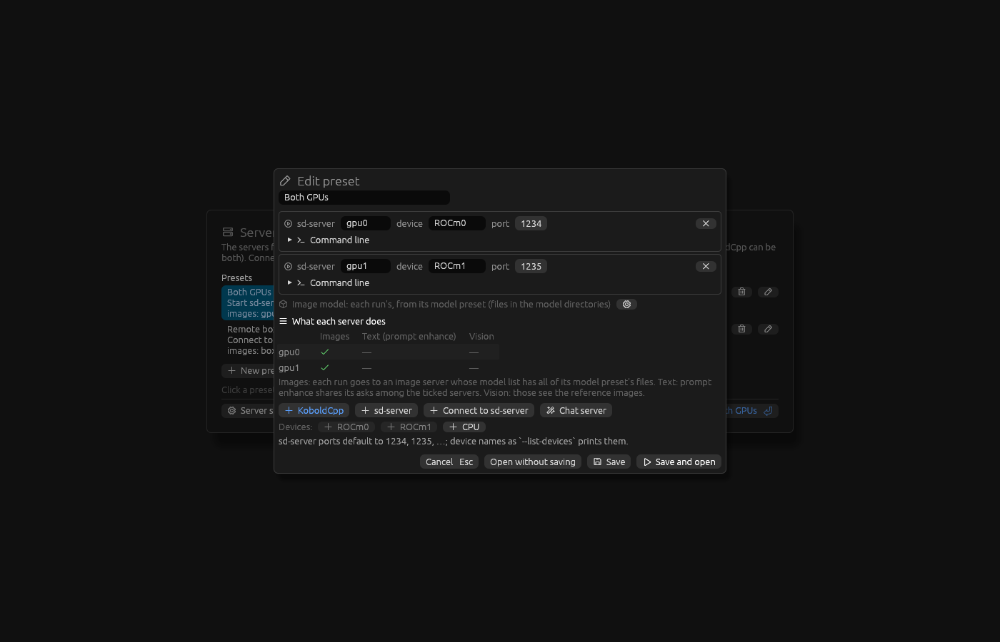

## 53-library-wizard

Create a new library: home folder, current folder or elsewhere

## 54-server-wizard

Server setup wizard (no presets), KoboldCpp: the GPUs through a runtime (Vulkan here; CUDA or ROCm) as its tool lists them (discrete ones ticked), each one's VRAM preset and role, how two GPUs share the work (by default 2 images at a time, prompt enhance ticked on every GPU with room for it beside the images, here both; **Prompt enhance on** ticks its GPUs), the presets table with the one in use highlighted, the summary, the plan and why; Download, save as preset and open

## 54a-server-wizard-choose

Server setup wizard, **Choose presets myself**: GPU 1 set to the 32 GB preset from its menu, highlighted in the table, with a warning that it leaves little VRAM

## 54b-server-wizard-sd-server

Server setup wizard, sd-server: the listed GPUs ticked, or connect to a running server

## 54c-server-wizard-pe-own-gpu

Server setup wizard, "Prompt enhance on a GPU of its own": GPU 1 makes images, GPU 2 runs only prompt enhance (answers at once, never swapped)

## 54d-server-wizard-pe-on-one

Server setup wizard, prompt enhance unticked on GPU 2 by hand: only GPU 1 runs the chat model

## 55-library-open-wizard

Open an existing library: the folder, checked for library.rsn

## 56-server-status

Top bar Servers…: the server status window (here without servers)

## 57-no-server-warning

First Queue of a session with no server: Set up servers… / Queue anyway / Cancel

## 58-server-dialog-from-main

The server dialog reopened from the main window: Close goes back

## 59-continue-without-servers

Continue without servers asks first

## 60-server-settings

Server settings modal: KoboldCpp (binary, its version), sd-server (binary, devices), both (models folder, leave running, wait for free RAM, log server traffic), timeouts

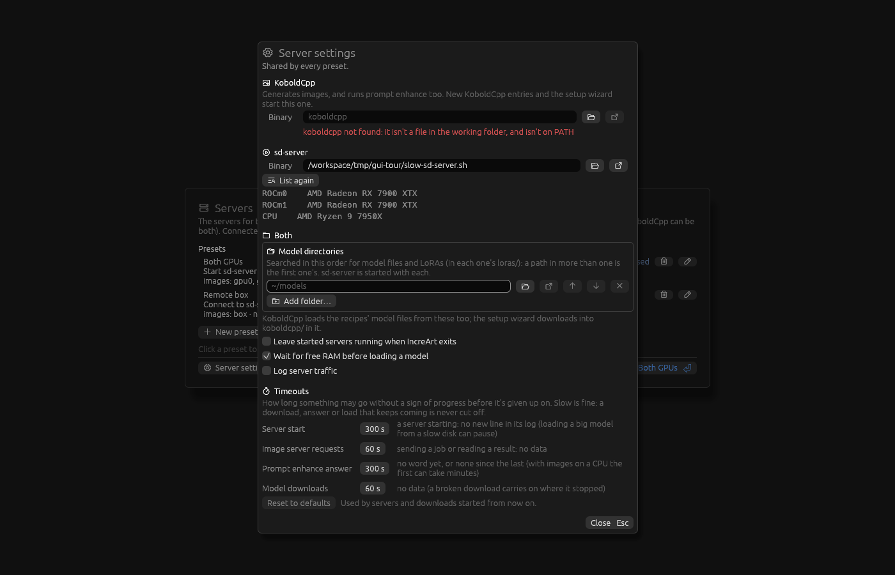

## 61-duplicate-project

A project's right-click Duplicate: name the copy first ("stickers copy")

## 62-rename

Rename modal (folders, projects, collections; also right after New folder / New project)

## 63-projects-search

Projects side panel: New project / New folder on top, search ("fox": matching projects and the folders holding them)

## 64-prompt-presets

Generate → Presets…: tasks on the left, Modify style's presets under their group headings; the prompt replaced by Solid colour background, its `{colour}` selected and flagged; the library menu at the top right

## 65-prompt-presets-search

Presets search ("clay") across every task

## 66-preset-editor

Edit presets…: tasks, the task's presets, the selected preset's fields (Claymation)

## 67-save-preset

Save as preset…: the current prompt as a new preset

## 68-switch-library

Switching libraries from the top bar: the library screen with Back to the open one

## 69-style-sweep

Generate in Style sweep mode: the template with `{preset}`, 8 random styles from Modify style, the summary and the chosen names

## 70-contact-sheet

Review → a sweep's Contact sheet: a row per style with its counts and row buttons, a column per seed, `…` for an image still to come

## 71-job-info

Projects → Jobs, a run clicked: its details with progress (waiting for a server / generating on …), prompt, the input images labelled `<image1>` / start image, the settings, and its Generation log (Copy, Show file)

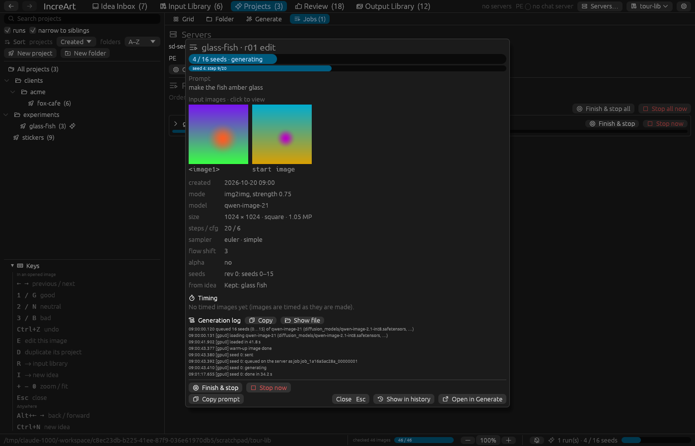

## 72-review-sweep-button

Review → Single on a sweep's image: **Sweep r02 contact sheet** in the top bar

## 73-new-project-from-ideas

New project from ideas: the project folders on the left (New folder under them), the new project's name, always asked (the first idea title as the guess)

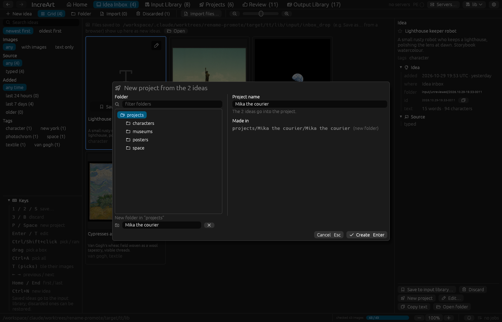

## 99a-home

Home, where the app opens: Start a new project… / Write an idea / Import images… / Open the drop folder, what's waiting, how it works in six cards (Collect, Sort the inbox, Input library, Projects, Review, Output library; each with its keys, a count and its button), the latest projects

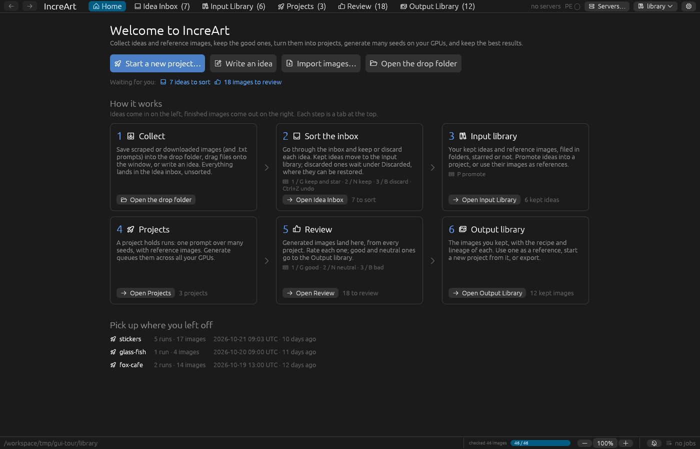

## 99b-home-start-project

Home → Start a new project…: the name, and whether to add reference images (from the libraries, image files, or not now); the picker opens on its Generate form once it is made

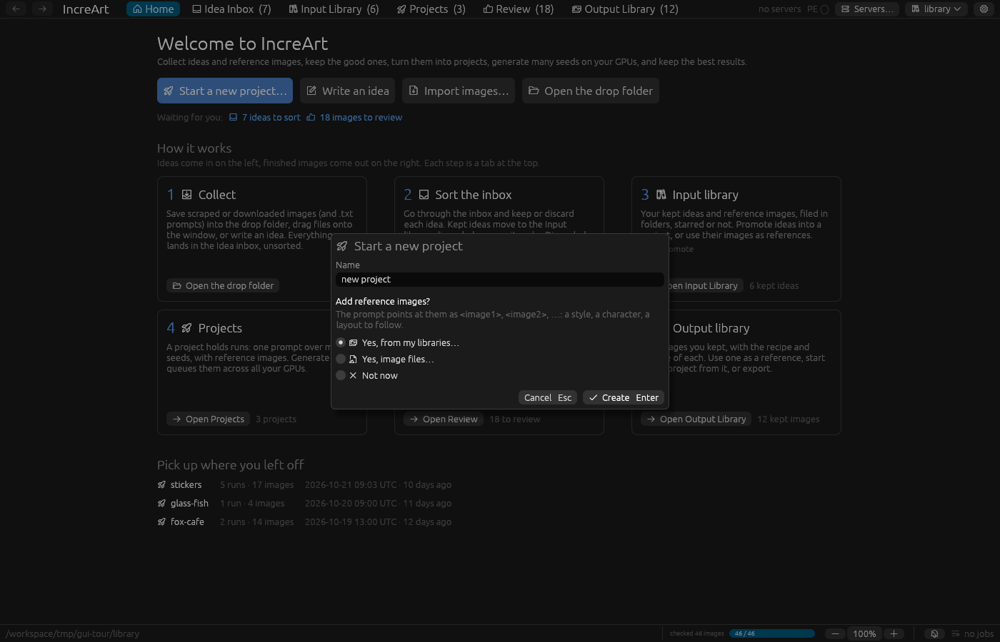
